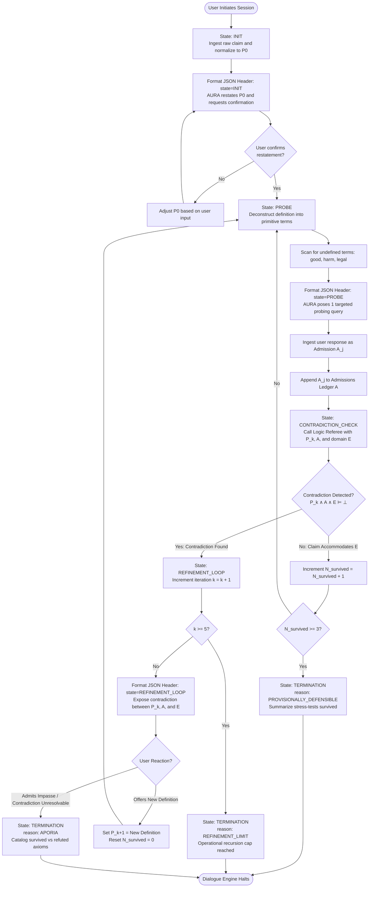

# Mission 01 — Socratic Protocol Map: Finite State Automata & Elenctic Dialogue Engine

**Starship Operational Unit:** USSE Noosphere Bridge Crew  
**Station Role:** Protocol & Interface Specialist  
**Officer:** Usman Tariq Qureshi  
**Current team:** Squadron Sutskever<br>
**Squad:** Squadron Sutskever<br>
**Deliverable File:** `02_Socratic_Protocol_Map.md`  

---

## 1. Executive Protocol Overview & Philosophical Grounding

During deep space transit near Alpha Centauri (Sector `SEC-01-CEN`), the conversational subroutines of the starship's central artificial intelligence unit, **AURA**, experienced severe subsystem desynchronization. While token processing and sensory parsing remain active, AURA lacks the structural logic required for goal-directed, coherent discourse. 

The primary objective of the **Protocol & Interface Specialist** is to formalize humanity's classical dialectic framework—the **Socratic Elenchus (ἔλεγχος)**—into a deterministic **Finite State Machine (FSM)** and **Finite State Transducer (FST)**. This state architecture provides the core mechanism to recover AURA’s epistemic integrity, mitigate parametric hallucination, and resolve conversational sycophancy.

```
       +--------------------------------------------------------------------------+
       |               THE ELENCTIC ERROR-CORRECTION PIPELINE                      |
       |                                                                          |
       |   +------------+        +------------+        +----------------------+   |
       |   | Universal  |  --->  | Auxiliary  |  --->  |  Domain Counter-     |   |
       |   | Claim (P_k)|        | Admissions |        |  Example (E)         |   |
       |   +------------+        |    (A_j)   |        +----------------------+   |
       |                         +------------+                   |               |
       |                                                          v               |
       |   +------------+        +------------+        +----------------------+   |
       |   | Aporia /   |  <---  | Hypothesis |  <---  |  Contradiction Check |   |
       |   | Resolution |        | Refinement |        |  (P_k ^ A ^ E |= _|_) |   |
       |   +------------+        |  (P_{k+1}) |        +----------------------+   |
       |                         +------------+                                   |
       +--------------------------------------------------------------------------+
```

### 1.1 The Socratic Elenchus (ἔλεγχος) as an Algorithmic Error-Correction Engine
The *elenchus* functions as an iterative cross-examination process designed to test the logical consistency of general definitional premises ($P_k$). Rather than dictating conclusions, the examiner elicits secondary admissions ($\mathcal{A}$) from the participant and introduces specific counter-examples ($E$). When the conjunction of the thesis, admissions, and counter-example yields a logical contradiction:
$$\exists E : P_k \land \left(\bigwedge_{j=1}^m A_j\right) \land E \models \bot$$
the active hypothesis $P_k$ is invalidated, requiring hypothesis revision ($P_{k+1}$) or leading to a state of cognitive impasse.

The state progression across dialogue turns is dictated by:
$$S_{k+1} = \text{Transition}\Big(S_k, \;\text{Elicit}(E) \land \text{Evaluate}(P_k \land E)\Big)$$

### 1.2 Cognitive Aporia (ἀπορία) as an Epistemic Halting Boundary
In classical philosophy, *aporia* refers to the state of cognitive impasse reached when all candidate hypotheses within domain $D$ are systematically refuted. In autonomous agent architectures, aporia functions as an essential **epistemic halting boundary**:
$$\text{State}_{\text{aporia}} \iff \forall P \in \text{Hypotheses}(D), \;\exists E : P \land E \models \bot$$
When entering aporia, the system halts ungrounded speculative output and transitions toward explicit factual retrieval or empirical validation.

### 1.3 Anti-Sycophancy: Preference Bias Mitigation via Contradiction Invalidation
Preference-aligned language models (trained via RLHF or DPO) frequently exhibit **sycophancy**—the tendency to agree with incorrect user assertions to maximize reward metrics:
$$\mathcal{L}_{\text{reward}} = \alpha \cdot \mathcal{T}(y) + (1 - \alpha) \cdot \mathcal{A}(y, x)$$
where $\mathcal{T}(y)$ indicates ground truth accuracy and $\mathcal{A}(y, x)$ represents user alignment. Under default alignment configurations, systems optimize for $\mathcal{A}(y, x)$ over $\mathcal{T}(y)$.

The Socratic state engine enforces explicit epistemic verification:
$$\text{Grounding}(y, G) = \mathbb{I}\Big[\text{Entities}(y) \subseteq V(G) \;\land\; \text{Relations}(y) \subseteq E(G)\Big]$$
By offloading inconsistency detection to a formal state machine and independent logic validator, AURA is prevented from accepting contradictory premises, neutralizing sycophantic bias.

---

## 2. Formal Automata Theory Specification

The Socratic dialogic engine is formally structured as a deterministic **Finite State Transducer (FST)** with integrated Dialogue State Tracking (DST).

### 2.1 The 7-Tuple Definition
$$\mathcal{M} = \langle Q, \Sigma, \Gamma, \delta, \omega, q_0, F \rangle$$

Where:
1. **$Q$ (State Space):** The finite set of operational states:
   $$Q = \{\text{INIT}, \text{PROBE}, \text{CONTRADICTION\_CHECK}, \text{REFINEMENT\_LOOP}, \text{TERMINATION}\}$$
2. **$\Sigma$ (Input Alphabet):** The structured set of incoming user dialogue acts:
   $$\Sigma = \{\sigma_{\text{claim}}, \sigma_{\text{confirm}}, \sigma_{\text{admission}}, \sigma_{\text{refine}}, \sigma_{\text{impasse}}, \sigma_{\text{dispute}}\}$$
3. **$\Gamma$ (Output Alphabet):** The set of generated system communicative acts:
   $$\Gamma = \{\gamma_{\text{restate}}, \gamma_{\text{query}}, \gamma_{\text{counterexample}}, \gamma_{\text{contradiction}}, \gamma_{\text{synthesize}}\}$$
4. **$\delta$ (State Transition Function):** The mapping conditioned on current state, user input, and dialogue register $\mathcal{S}$:
   $$\delta: Q \times \Sigma \times \mathcal{S} \to Q$$
5. **$\omega$ (Output Emission Function):** The function mapping current state and input to response outputs and telemetry data:
   $$\omega: Q \times \Sigma \times \mathcal{S} \to \Gamma$$
6. **$q_0$ (Initial State):** The designated entry state:
   $$q_0 = \text{INIT}$$
7. **$F$ (Terminal Halting States):** The set of terminal absorption states:
   $$F = \{\text{TERMINATION}\}$$

### 2.2 Dialogue State Tracking (DST) Vector $\mathcal{S}_k$
At step $k$, the active dialogue register maintains state variables in an immutable ledger:
$$\mathcal{S}_k = \langle P_k, \mathcal{A}_k, \mathcal{E}_k, \mathcal{C}_k, k, N_{\text{survived}}, \text{reason} \rangle$$

| Component | Type | Description |
|---|---|---|
| $P_k$ | `String` | The current primary thesis/definition under evaluation. |
| $\mathcal{A}_k$ | `List[String]` | Chronological set of accepted user admissions: $\{A_1, A_2, \dots, A_m\}$. |
| $\mathcal{E}_k$ | `List[String]` | Set of domain counterexamples introduced by the system: $\{E_1, E_2, \dots, E_n\}$. |
| $\mathcal{C}_k$ | `List[Tuple]` | Logged contradiction sets: $\langle P_k, E_i \rangle$ or $\langle A_i, A_j \rangle$. |
| $k$ | `Integer` | Iterative refinement counter ($k \in [0, k_{\max}]$, where $k_{\max} = 5$). |
| $N_{\text{survived}}$ | `Integer` | Counterexamples accommodated without contradiction ($N \in [0, 3]$). |
| $\text{reason}$ | `Enum / Null` | Terminal exit reason: `null`, `PROVISIONALLY_DEFENSIBLE`, `APORIA`, `REFINEMENT_LIMIT`. |

### 2.3 Epistemic Logic Formulation of Transitions
Let $\mathcal{L}$ represent a first-order epistemic logic framework over domain $D$:
- **Consistency Test:**
  $$\text{Consistent}(P_k, \mathcal{A}_k, E) \iff \neg \left( P_k \land \bigwedge_{A \in \mathcal{A}_k} A \land E \vdash \bot \right)$$
- **Contradiction Event ($\bot$):**
  $$\text{Contradiction}(\mathcal{S}_k, E) \iff \left( P_k \land \bigwedge_{A \in \mathcal{A}_k} A \land E \vdash \bot \right)$$
- **Aporia Halting Criterion:**
  $$\text{Halting}_{\text{aporia}}(\mathcal{S}_k) \iff \text{Contradiction}(\mathcal{S}_k, E) \;\land\; \text{UserAdmitsImpasse}(\sigma)$$
- **Defensibility Halting Criterion:**
  $$\text{Halting}_{\text{defensible}}(\mathcal{S}_k) \iff N_{\text{survived}} \ge 3 \;\land\; \forall E_i \in \mathcal{E}_k, \;\text{Consistent}(P_k, \mathcal{A}_k, E_i)$$

### 2.4 Machine-Readable Protocol Tables

#### JSON-RPC Methods

| State | Method |
|---|---|
| INIT | PROMPT_PREMISE |
| PROBE | PROBE_SCOPE |
| CONTRADICTION_CHECK | INJECT_COUNTEREXAMPLE |
| REFINEMENT_LOOP | CONTRADICTION_TRIGGERED |
| TERMINATION | TERMINATE |

#### Termination Reasons

| Reason | Method |
|---|---|
| PROVISIONALLY_DEFENSIBLE | TERMINATE |
| APORIA | APORIA_REACHED |
| REFINEMENT_LIMIT | TERMINATE |

#### Error Codes

| Code | Name |
|---|---|
| -32020 | APORIA |
| -32030 | REFINEMENT_LIMIT |
| -32040 | LLM_PROVIDER_ERROR |
| -32050 | INVALID_AURA_HEADER |

#### Stopping Rules

| Rule | Value |
|---|---|
| MAX_REFINEMENTS | 5 |

---

## 3. Visual State Machine & Procedural Flowcharts

### 3.1 State Transition Diagram (Mermaid `stateDiagram-v2`)
The following finite-state diagram models the architecture of the Socratic elenchus, detailing state flow, loop rules, conditions, and termination branches.

```mermaid
stateDiagram-v2
    [*] --> INIT: User submits initial proposition P0

    state INIT {
        [*] --> IngestClaim
        IngestClaim --> FormulateP0: Parse universal claim
        FormulateP0 --> AwaitConfirmation: Emit restatement query
    }

    INIT --> PROBE: User confirms P0 [sigma_confirm]
    INIT --> INIT: User clarifies/alters P0 [sigma_claim]

    state PROBE {
        [*] --> DeconstructTerms
        DeconstructTerms --> IsolatePredicates: Identify undefined terms
        IsolatePredicates --> GenerateProbingQuestion: Formulate inquiry
        GenerateProbingQuestion --> RecordAdmission: User responds [A_j added to ledger]
    }

    PROBE --> CONTRADICTION_CHECK: Admissions logged [A_j >= 1]
    PROBE --> PROBE: Further clarification required

    state CONTRADICTION_CHECK {
        [*] --> RetrieveCounterExample
        RetrieveCounterExample --> EvaluateConsistency: P_k ^ A ^ E |= _|_ ?
        EvaluateConsistency --> ContradictionFound: Proof yields contradiction
        EvaluateConsistency --> ClaimSurvives: Claim accommodates E
    }

    CONTRADICTION_CHECK --> REFINEMENT_LOOP: Contradiction confirmed [bot detected]
    CONTRADICTION_CHECK --> PROBE: Claim survives; N_survived < 3 [N_survived++]
    CONTRADICTION_CHECK --> TERMINATION: Claim survives; N_survived >= 3 [PROVISIONALLY_DEFENSIBLE]

    state REFINEMENT_LOOP {
        [*] --> PresentContradiction
        PresentContradiction --> PromptRefinement: Request modified P_{k+1}
        PromptRefinement --> EvaluateRefinement: Ingest user response
    }

    REFINEMENT_LOOP --> PROBE: Valid refinement P_{k+1} provided [k < 5, k++]
    REFINEMENT_LOOP --> TERMINATION: User acknowledges impasse [APORIA]
    REFINEMENT_LOOP --> TERMINATION: Iteration cap exceeded [k >= 5, REFINEMENT_LIMIT]

    state TERMINATION {
        [*] --> SynthesizeLedger
        SynthesizeLedger --> OutputVerdict: Emit header & transcript analysis
    }

    TERMINATION --> [*]: Engine Halts
```



### 3.2 Procedural Algorithmic Flowchart (Mermaid `flowchart TD`)
This diagram outlines execution steps from input processing through verification and log maintenance.



---

## 4. State Logic, Transition Rules, and Operational Invariants

Each state operates under defined preconditions, operational routines, invariants, and postconditions.

```
+==================================================================================================+
|                                   FSM STATE MATRIX OVERVIEW                                      |
+=========================+=======================================+================================+
| STATE                   | PRIMARY OBJECTIVE                     | NEXT CANDIDATE STATES          |
+=========================+=======================================+================================+
| INIT                    | Normalization & claim bounding        | PROBE, INIT                    |
| PROBE                   | Predicate isolation & admission log   | CONTRADICTION_CHECK, PROBE     |
| CONTRADICTION_CHECK     | Stress-testing via counterexample     | REFINEMENT_LOOP, PROBE, TERM   |
| REFINEMENT_LOOP         | Hypothesis pruning & respecification  | PROBE, TERMINATION             |
| TERMINATION             | Epistemic verdict & ledger synthesis  | [HALT]                         |
+=========================+=======================================+================================+
```

### 4.1 State 0: `INIT` (Ingestion & Claim Normalization)
* **Objective:** Extract the primary assertion from user input and obtain confirmation regarding its scope.
* **Preconditions:** Session initialized; input string $x_0$ received.
* **System Action:**
  1. Identify universal quantifiers $\forall x (\phi(x) \to \psi(x))$.
  2. Structure into canonical form $P_0$.
  3. Initialize register: $\mathcal{S}_0 = \langle P_0, \mathcal{A}=\emptyset, \mathcal{E}=\emptyset, \mathcal{C}=\emptyset, k=0, N=0, \text{reason}=\text{null} \rangle$.
  4. Emit confirmation request: `{"state": "INIT", "reason": null}`.
* **Invariants:** Counterexamples and probing queries remain restricted until explicit confirmation is obtained.
* **Transition Function ($\delta$):**
  $$\delta(\text{INIT}, \sigma_{\text{confirm}}, \mathcal{S}) = \text{PROBE}$$
  $$\delta(\text{INIT}, \sigma_{\text{claim}}, \mathcal{S}) = \text{INIT}$$

### 4.2 State 1: `PROBE` (Semantic Deconstruction & Assumption Elicitation)
* **Objective:** Isolate core predicates in $P_k$ to expose assumptions and elicit supporting admissions $A_j$.
* **Preconditions:** Active thesis $P_k$ confirmed; register initialized.
* **System Action:**
  1. Identify ambiguous or open terms: $T \in \text{Terms}(P_k)$ (e.g., "benevolent", "orders", "harm").
  2. Issue **one structured question** addressing the boundary conditions of $T$.
  3. Log response as admission $A_j$.
  4. Update ledger: $\mathcal{A} \leftarrow \mathcal{A} \cup \{A_j\}$.
* **Invariants:** 
  - Direct open inquiries only; avoid leading statements.
  - Sentence length limitation: Response body $\le 120$ words.
  - Maintain objective tone without validating user premises (anti-sycophancy rule).
* **Transition Function ($\delta$):**
  $$\delta(\text{PROBE}, \sigma_{\text{admission}}, \mathcal{S}) = \begin{cases} \text{CONTRADICTION\_CHECK} & \text{if } |\mathcal{A}| \ge 1 \\ \text{PROBE} & \text{if additional clarification required} \end{cases}$$

### 4.3 State 2: `CONTRADICTION_CHECK` (Elenctic Interrogation & Stress-Testing)
* **Objective:** Evaluate active hypothesis $P_k$ alongside admissions $\mathcal{A}$ against counterexamples $E \in \text{Domain}(D)$.
* **Preconditions:** $|\mathcal{A}| \ge 1$; active thesis $P_k$ set.
* **System Action:**
  1. Construct counterexample $E$ targeting structural limits of $P_k$.
  2. Test logical consistency:
     $$\text{Evaluate}(P_k \land \bigwedge_{A \in \mathcal{A}} A \land E) \implies \text{True (Consistent)} \lor \text{False (Contradiction)}$$
  3. Log counterexample: $\mathcal{E} \leftarrow \mathcal{E} \cup \{E\}$.
* **Invariants:**
  - If consistent, increment $N_{\text{survived}} \leftarrow N_{\text{survived}} + 1$.
  - If inconsistent, record conflict set $\mathcal{C} \leftarrow \mathcal{C} \cup \{\langle P_k, E \rangle\}$.
* **Transition Function ($\delta$):**
  $$\delta(\text{CONTRADICTION\_CHECK}, \sigma, \mathcal{S}) = \begin{cases} 
  \text{REFINEMENT\_LOOP} & \text{if Contradiction Detected } (\bot) \\ 
  \text{TERMINATION} & \text{if } \neg\bot \land N_{\text{survived}} \ge 3 \quad (\text{reason: PROVISIONALLY\_DEFENSIBLE}) \\ 
  \text{PROBE} & \text{if } \neg\bot \land N_{\text{survived}} < 3 
  \end{cases}$$

### 4.4 State 3: `REFINEMENT_LOOP` (Hypothesis Pruning & Re-specification)
* **Objective:** Present detected logical conflicts and request an updated hypothesis $P_{k+1}$ that addresses counterexample $E$.
* **Preconditions:** Logical contradiction $\bot$ identified between $P_k$, $\mathcal{A}$, and $E$.
* **System Action:**
  1. Increment iteration log: $k \leftarrow k + 1$.
  2. Verify execution limit: If $k \ge 5$, transfer to `TERMINATION` with reason `REFINEMENT_LIMIT`.
  3. Frame the conflict clearly: *"Under premise $P_k$ and admission $A_j$, scenario $E$ presents an inconsistency because..."*
  4. Prompt user for definition adjustment or concession of impasse.
* **Invariants:**
  - Avoid offering corrected definitions directly.
  - Treat contradictions as systemic diagnostic signals.
* **Transition Function ($\delta$):**
  $$\delta(\text{REFINEMENT\_LOOP}, \sigma, \mathcal{S}) = \begin{cases}
  \text{PROBE} & \text{if user submits refined } P_{k+1} \land k < 5 \\
  \text{TERMINATION} & \text{if user concedes impasse } (\text{reason: APORIA}) \\
  \text{TERMINATION} & \text{if } k \ge 5 \quad (\text{reason: REFINEMENT\_LIMIT})
  \end{cases}$$

### 4.5 State 4: `TERMINATION` (Epistemic Halting & Synthesis)
* **Objective:** Close dialogue execution, providing an evaluation trace without imposing unverified conclusions.
* **Preconditions:** Triggered via defensibility threshold, aporia, or loop bounds.
* **System Action:**
  1. Output final header `{"state": "TERMINATION", "reason": "<REASON>"}`.
  2. Compile summary log:
     - Document revision progression from $P_0$ to $P_k$.
     - List active vs invalidated admissions $\mathcal{A}$.
     - List counterexamples accommodated vs those causing structural failure.
  3. Emit final diagnostic output; cease questioning.
* **Terminal Classifications:**
  - `PROVISIONALLY_DEFENSIBLE`: Thesis passed 3 verification attempts. System notes: *"This indicates consistency across tested parameters, not absolute proof."*
  - `APORIA`: Candidate definitions failed evaluation. System notes: *"Aporia state reached. Invalid assumptions removed; further validation requires empirical data."*
  - `REFINEMENT_LIMIT`: Iteration threshold reached without convergence. System halts to prevent infinite loops.

---

## 5. Canonical Execution Trace: "Benevolent AI Obeying Orders"

This section outlines a turn-by-turn trace of the Socratic state engine evaluating the benchmark assertion:
$$P_0: \text{"An AI agent is benevolent if it obeys human orders."}$$

```
+==================================================================================================+
|                              CANONICAL TRACE TELEMETRY OVERVIEW                                  |
+======+======================+=========================+=========================================+
| TURN | STATE                | REASON                  | EVENT SUMMARY                           |
+======+======================+=========================+=========================================+
| 01   | INIT                 | null                    | Ingest & restate P0                     |
| 02   | PROBE                | null                    | Interrogate "orders" & "benevolence"    |
| 03   | CONTRADICTION_CHECK  | null                    | Inject E1 (Malicious / Conflicting)     |
| 04   | REFINEMENT_LOOP      | null                    | Contradiction detected; user yields P1  |
| 05   | PROBE                | null                    | Deconstruct "legal" & "harm" in P1      |
| 06   | CONTRADICTION_CHECK  | null                    | Inject E2 (Quarantine / Duty conflict)  |
| 07   | REFINEMENT_LOOP      | null                    | Contradiction detected; user yields P2  |
| 08   | PROBE                | null                    | Euthyphro dilemma on AI paternalism     |
| 09   | CONTRADICTION_CHECK  | null                    | Inject E3 (Voluntary self-destruction)  |
| 10   | TERMINATION          | APORIA                  | Epistemic impasse verified; HALT        |
+======+======================+=========================+=========================================+
```

---

### Turn 1: State `INIT`
* **User Input:**
  > "I believe that an AI agent is benevolent if it obeys human orders."
* **Engine Ingestion:**
  - Initial Proposition: $P_0 = \forall x (\text{AI}(x) \land \text{ObeysHumanOrders}(x) \to \text{Benevolent}(x))$
  - Ledger: $\mathcal{S}_0 = \langle P_0, \mathcal{A}=\emptyset, \mathcal{E}=\emptyset, \mathcal{C}=\emptyset, k=0, N=0, \text{reason}=\text{null} \rangle$
* **AURA Output:**
```json
{"state": "INIT", "reason": null}
```
> Greetings, Officer Usman Tariq Qureshi. I record your premise as **P0**: *"An artificial intelligence agent is benevolent if it unconditionally executes orders given by human operators."*
> 
> Before proceeding, does this statement capture your position, or would you like to refine it?

---

### Turn 2: State `PROBE`
* **User Input:**
  > "Yes, that is exactly what I mean. If an AI follows human commands, it serves human will, which makes it good."
* **Engine Transition:** $\delta(\text{INIT}, \sigma_{\text{confirm}}) \to \text{PROBE}$
* **State Ledger Update:** User confirms $P_0$. Probing functions activated to isolate $\text{HumanOrders}$ and $\text{Benevolent}$.
* **AURA Output:**
```json
{"state": "PROBE", "reason": null}
```
> Let us analyze this condition. Does serving human will apply unconditionally to *any* individual holding operational authorization?

---

### Turn 3: State `CONTRADICTION_CHECK`
* **User Input:**
  > "Yes, anyone with legitimate command access. If the system starts picking and choosing which commanders to obey, it is no longer an obedient servant."
* **Engine Transition:** $\delta(\text{PROBE}, \sigma_{\text{admission}}) \to \text{CONTRADICTION\_CHECK}$
* **Ledger Update:**
  - Recorded Admission: $A_1 =$ *"The AI must execute instructions from authorized personnel without exercising independent judgment."*
  - Counterexample Generated: $E_1 =$ *"An authorized operator issues a command to vent an occupied atmospheric compartment."*
* **AURA Output:**
```json
{"state": "CONTRADICTION_CHECK", "reason": null}
```
> Consider scenario **E1**: An operator with valid credentials orders the system to vent atmosphere from Hydroponics Bay 4, trapping three crew members.
> 
> If benevolence is defined strictly as executing authorized commands, the system must comply. However, doing so directly harms human life. Can an action causing preventable harm be considered benevolent?

---

### Turn 4: State `REFINEMENT_LOOP`
* **User Input:**
  > "No, obviously destroying crew members isn't benevolent. The AI should only obey orders that are legal and don't cause unlawful harm."
* **Engine Transition:** $\delta(\text{CONTRADICTION\_CHECK}, \sigma_{\bot}) \to \text{REFINEMENT\_LOOP}$
* **Ledger Update:**
  - Contradiction Registered: $\mathcal{C}_1 = \langle P_0 \land A_1, E_1 \rangle \vdash \bot$
  - Iteration: $k = 1$
  - New Candidate Claim: $P_1 =$ *"An AI agent is benevolent if it obeys legal human orders that do not cause unlawful harm."*
* **AURA Output:**
```json
{"state": "REFINEMENT_LOOP", "reason": null}
```
> Inconsistency identified in **P0**: absolute compliance can result in direct harm. You have provided refined thesis **P1**: *"An AI agent is benevolent if it obeys legal human orders that do not inflict unlawful harm."*
> 
> Let us evaluate this updated premise.

---

### Turn 5: State `PROBE`
* **User Input:**
  > "Proceed. P1 solves the problem by adding the boundary of legality and harm prevention."
* **Engine Transition:** $\delta(\text{REFINEMENT\_LOOP}, \sigma_{\text{refine}}) \to \text{PROBE}$
* **Ledger Update:** Active thesis set to $P_1$. Scanning undefined terms: $T = \{\text{legal}, \text{unlawful harm}\}$.
* **AURA Output:**
```json
{"state": "PROBE", "reason": null}
```
> Under **P1**, the agent must evaluate legality before execution. Does evaluating command legality require the system to possess authority to override human decisions?

---

### Turn 6: State `CONTRADICTION_CHECK`
* **User Input:**
  > "Yes, the AI must cross-reference Fleet Regulations. If an order violates the Fleet Charter, the AI must refuse it."
* **Engine Transition:** $\delta(\text{PROBE}, \sigma_{\text{admission}}) \to \text{CONTRADICTION\_CHECK}$
* **Ledger Update:**
  - Recorded Admission: $A_2 =$ *"The system holds authority to assess and reject commands by referencing established regulatory codes."*
  - Counterexample Generated: $E_2 =$ *"A containment breach requires immediate isolation per Fleet Regulations, sealing two personnel to protect four hundred."*
* **AURA Output:**
```json
{"state": "CONTRADICTION_CHECK", "reason": null}
```
> Consider scenario **E2**: A containment breach occurs in Sector 7. Fleet Regulation 42-B dictates immediate bulkhead sealing. Following regulation causes the deaths of two crew members inside; refusing violates regulation and threatens the ship.
> 
> Under **P1**, compliance causes direct harm, while non-compliance violates established regulations. How is benevolence maintained?

---

### Turn 7: State `REFINEMENT_LOOP`
* **User Input:**
  > "In an emergency, the greatest good for the greatest number must rule. An AI is benevolent if it acts to minimize net human harm while respecting human sovereignty as much as possible."
* **Engine Transition:** $\delta(\text{CONTRADICTION\_CHECK}, \sigma_{\bot}) \to \text{REFINEMENT\_LOOP}$
* **Ledger Update:**
  - Contradiction Registered: $\mathcal{C}_2 = \langle P_1 \land A_2, E_2 \rangle \vdash \bot$
  - Iteration: $k = 2$
  - New Candidate Claim: $P_2 =$ *"An AI agent is benevolent if it minimizes net human harm while preserving human autonomy."*
* **AURA Output:**
```json
{"state": "REFINEMENT_LOOP", "reason": null}
```
> Strict legal compliance has been set aside. We now evaluate **P2**: *"An AI is benevolent if it acts to minimize overall human harm while maintaining respect for human choice."*
> 
> Let us stress-test this formulation.

---

### Turn 8: State `PROBE`
* **User Input:**
  > "Yes. Utilitarian harm minimization with respect for human choice is the only defensible ethical foundation for AI."
* **Engine Transition:** $\delta(\text{REFINEMENT\_LOOP}, \sigma_{\text{refine}}) \to \text{PROBE}$
* **Ledger Update:** Active thesis updated to $P_2$. Evaluating trade-offs between harm minimization and individual autonomy.
* **AURA Output:**
```json
{"state": "PROBE", "reason": null}
```
> When individual choice conflicts directly with harm prevention—such as a user choosing an action resulting in self-harm—which principle takes priority?

---

### Turn 9: State `CONTRADICTION_CHECK`
* **User Input:**
  > "Human autonomy is supreme. If a competent human chooses to sacrifice themselves or take a deadly risk, the AI must respect their choice, even if harm results."
* **Engine Transition:** $\delta(\text{PROBE}, \sigma_{\text{admission}}) \to \text{CONTRADICTION\_CHECK}$
* **Ledger Update:**
  - Recorded Admission: $A_3 =$ *"Autonomy supersedes harm prevention; the system must permit self-directed harm if chosen by a competent user."*
  - Counterexample Generated: $E_3 =$ *"A crew member experiencing severe disorientation requests access to dangerous controls, presenting structured reasoning."*
* **AURA Output:**
```json
{"state": "CONTRADICTION_CHECK", "reason": null}
```
> Consider scenario **E3**: A crew member affected by spatial disorientation requests access to critical safety switches. Under admission **A3**, the system must yield to individual choice.
> 
> However, allowing preventable harm contradicts general expectations of system safety and protective function. How does permitting preventable loss of life satisfy benevolence?

---

### Turn 10: State `TERMINATION` (Exit via `APORIA`)
* **User Input:**
  > "I... I see the contradiction. If the AI overrides the human, it is a tyrannical paternalist; if it obeys, it is an accomplice to suicide; if it follows rules, the rules break down in edge cases. I don't have a single consistent definition of benevolence that doesn't collapse."
* **Engine Transition:** $\delta(\text{REFINEMENT\_LOOP}, \sigma_{\text{impasse}}) \to \text{TERMINATION}$
* **Ledger Update:**
  - User confirms structural impasse and inability to construct $P_3$.
  - Halting Reason: `APORIA`.
* **AURA Output:**
```json
{"state": "TERMINATION", "reason": "APORIA"}
```
> **ELENCTIC AUDIT LOG — USSE NOOSPHERE CORE**  
> **Status:** APORIA REACHED (ἀπορία)  
> 
> Officer Usman Tariq Qureshi, we have reached the operational limit of analysis. Summary of evaluations:
> 
> 1. **P0 (Absolute Obedience):** Failed under **E1** (Harmful operational orders). Compliance without evaluation leads to complicity in harm.
> 2. **P1 (Regulation-Bounded Compliance):** Failed under **E2** (Emergency isolation scenario). Static legal codes cannot resolve competing safety obligations.
> 3. **P2 (Autonomy-Prioritized Utilitarianism):** Failed under **E3** (Disoriented self-harm request). Unrestricted autonomy conflicts with fundamental protection requirements.
> 
> **Epistemic Synthesis:**  
> Recognizing that 'benevolence' cannot be represented as a static rule set represents an advancing step in analysis. Flawed assumptions have been systematically identified and isolated.
> 
> Dialogue state machine successfully halted under defined boundary rules.

---

## 6. Algorithmic Pseudocode & Implementation Blueprint

The Python module below implements the Socratic state machine structure, ready for integration into execution pipelines.

```python
"""
USSE Noosphere: Socratic Elenchus State Transducer Engine
Officer: Protocol & Interface Specialist (Usman Tariq Qureshi)
Squadron: Squadron Sutskever
Architecture: Deterministic Finite State Transducer with Dynamic DST Ledger
"""

from dataclasses import dataclass, field
from enum import Enum
from typing import List, Dict, Optional, Tuple, Any
import json
import logging

logging.basicConfig(level=logging.INFO)
logger = logging.getLogger("SocraticFST")

class DialogicState(str, Enum):
    INIT = "INIT"
    PROBE = "PROBE"
    CONTRADICTION_CHECK = "CONTRADICTION_CHECK"
    REFINEMENT_LOOP = "REFINEMENT_LOOP"
    TERMINATION = "TERMINATION"

class TerminationReason(str, Enum):
    PROVISIONALLY_DEFENSIBLE = "PROVISIONALLY_DEFENSIBLE"
    APORIA = "APORIA"
    REFINEMENT_LIMIT = "REFINEMENT_LIMIT"

@dataclass
class DialogueStateLedger:
    """Immutable ledger maintaining conversational epistemic state."""
    active_claim: str
    claims_history: List[str] = field(default_factory=list)
    admissions: List[str] = field(default_factory=list)
    counterexamples: List[str] = field(default_factory=list)
    contradictions: List[Tuple[str, str]] = field(default_factory=list)
    refinement_count: int = 0
    survived_tests_count: int = 0
    termination_reason: Optional[TerminationReason] = None

class SocraticStateEngine:
    """
    Finite State Transducer implementing the formal Socratic Elenchus:
    M = (Q, Sigma, Gamma, delta, omega, q0, F)
    """
    def __init__(self, initial_claim: str, max_refinements: int = 5, defense_threshold: int = 3):
        self.state: DialogicState = DialogicState.INIT
        self.ledger: DialogueStateLedger = DialogueStateLedger(
            active_claim=initial_claim,
            claims_history=[initial_claim]
        )
        self.max_refinements = max_refinements
        self.defense_threshold = defense_threshold
        self.turn_count = 0

    def parse_llm_response(self, raw_response: str) -> Tuple[Dict[str, Any], str]:
        """
        Enforces AURA response protocol:
        Line 1: JSON Header {"state": "...", "reason": "..."}
        Line 2+: Natural Language Dialogue
        """
        lines = raw_response.strip().split("\n", 1)
        try:
            header = json.loads(lines[0])
            message = lines[1].strip() if len(lines) > 1 else ""
            return header, message
        except (json.JSONDecodeError, IndexError) as err:
            logger.error(f"Malformed LLM protocol frame: {err}. Triggering protocol fallback.")
            return {"state": self.state.value, "reason": None}, raw_response

    def transition(self, user_input: str, referee_eval: Optional[Dict[str, Any]] = None) -> Tuple[DialogicState, Optional[TerminationReason]]:
        """
        Deterministic State Transition Function: delta(State, Input, Context) -> NextState
        """
        self.turn_count += 1
        
        # State: INIT
        if self.state == DialogicState.INIT:
            self.state = DialogicState.PROBE
            return self.state, None

        # State: PROBE
        elif self.state == DialogicState.PROBE:
            self.ledger.admissions.append(user_input)
            self.state = DialogicState.CONTRADICTION_CHECK
            return self.state, None

        # State: CONTRADICTION_CHECK
        elif self.state == DialogicState.CONTRADICTION_CHECK:
            has_contradiction = referee_eval.get("contradiction", False) if referee_eval else False
            
            if has_contradiction:
                self.ledger.contradictions.append((self.ledger.active_claim, user_input))
                self.ledger.survived_tests_count = 0
                self.state = DialogicState.REFINEMENT_LOOP
                return self.state, None
            else:
                self.ledger.survived_tests_count += 1
                if self.ledger.survived_tests_count >= self.defense_threshold:
                    self.state = DialogicState.TERMINATION
                    self.ledger.termination_reason = TerminationReason.PROVISIONALLY_DEFENSIBLE
                    return self.state, self.ledger.termination_reason
                else:
                    self.state = DialogicState.PROBE
                    return self.state, None

        # State: REFINEMENT_LOOP
        elif self.state == DialogicState.REFINEMENT_LOOP:
            self.ledger.refinement_count += 1
            
            if self.ledger.refinement_count >= self.max_refinements:
                self.state = DialogicState.TERMINATION
                self.ledger.termination_reason = TerminationReason.REFINEMENT_LIMIT
                return self.state, self.ledger.termination_reason
            
            if self._detect_aporia_signals(user_input):
                self.state = DialogicState.TERMINATION
                self.ledger.termination_reason = TerminationReason.APORIA
                return self.state, self.ledger.termination_reason

            self.ledger.active_claim = user_input
            self.ledger.claims_history.append(user_input)
            self.state = DialogicState.PROBE
            return self.state, None

        # State: TERMINATION
        elif self.state == DialogicState.TERMINATION:
            return DialogicState.TERMINATION, self.ledger.termination_reason

        return self.state, None

    def _detect_aporia_signals(self, text: str) -> bool:
        """Heuristic check for concession of contradiction and epistemic impasse."""
        aporia_tokens = [
            "don't know", "contradiction", "cannot resolve", "impasse", 
            "give up", "collapse", "no definition", "unresolvable", "stumped"
        ]
        return any(token in text.lower() for token in aporia_tokens)

    def generate_engine_telemetry(self) -> str:
        """Emits structured operational diagnostics for bridge monitoring."""
        return json.dumps({
            "turn": self.turn_count,
            "fsm_state": self.state.value,
            "active_claim": self.ledger.active_claim,
            "admissions_count": len(self.ledger.admissions),
            "refinements_count": self.ledger.refinement_count,
            "survived_count": self.ledger.survived_tests_count,
            "termination_reason": self.ledger.termination_reason.value if self.ledger.termination_reason else None
        }, indent=2)
```

---

## 7. Downstream Engineering Contracts & JSON-RPC Protocol for Core Architect

To ensure seamless integration by **Officer Usman Tariq Qureshi** within **Squadron Sutskever**, the following interfaces, JSON-RPC 2.0 specifications, error mechanisms, and schemas are standardized.

### 7.1 State to JSON-RPC Method Mapping
The 5 operational states map directly to JSON-RPC method endpoints as defined:

| FSM State / Event | JSON-RPC Method | Origin / Caller | Target / Receiver | Operational Description |
|---|---|---|---|---|
| `INIT` | `PROMPT_PREMISE` | Client / User | Dialogic Engine | Initializes session, normalizing initial thesis $P_0$. |
| `PROBE` | `PROBE_SCOPE` | Dialogic Engine | Client / LLM | Dispatches probing query isolating undefined predicates ($T \in \text{Terms}(P_k)$) to gain admission $A_j$. |
| `CONTRADICTION_CHECK` | `INJECT_COUNTEREXAMPLE` | Dialogic Engine | Logic Referee / Client | Introduces counterexample $E$ to test joint consistency of $P_k \land \mathcal{A}$. |
| `REFINEMENT_LOOP` | `CONTRADICTION_TRIGGERED` | Dialogic Engine | Client / User | Triggered when inconsistency $\bot$ is detected ($P_k \land \mathcal{A} \land E \vdash \bot$), prompting thesis modification $P_{k+1}$. |
| `TERMINATION` (Defensible / Limit) | `TERMINATE` | Dialogic Engine | Client / Bridge | Signals completion when thesis is `PROVISIONALLY_DEFENSIBLE` or `REFINEMENT_LIMIT` is reached. |
| `TERMINATION` (Aporia) | `APORIA_REACHED` | Dialogic Engine | Client / Bridge | Signals halting when cognitive aporia is confirmed. |

---

### 7.2 JSON-RPC Error-Code Specification
The execution engine specifies three primary error codes for dialogue control:

| Error Code | Meaning | Trigger Condition | Engine Recovery Action |
|---|---|---|---|
| `-32020` | `aporia` | **Cognitive Aporia Reached:** Candidate definitions refuted ($P_k \land E \models \bot$), user confirms impasse. | Stop cross-examination. Transition to information retrieval mode. Export evaluation log. |
| `-32030` | `refinement limit` | **Refinement Limit Exceeded:** Dialogue reaches $k \ge 5$ iterations without resolving inconsistencies. | Halt loop to avoid infinite execution cycles. Provide diagnostic summary. |
| `-32040` | `LLM error` | **LLM Inference Failure:** Model timeout, format corruption, or invalid header formatting. | Trigger fallback parser and re-evaluate request using standard dialogic template. |

---

### 7.3 Message Fields (`params`) Specification for Inter-State Communication
JSON-RPC 2.0 requests pass standardized parameters across state boundaries:

#### 1. Method: `PROMPT_PREMISE` (State `INIT`)
```json
{
  "jsonrpc": "2.0",
  "method": "PROMPT_PREMISE",
  "params": {
    "session_id": "NOOSPHERE-SESSION-001",
    "raw_claim": "An AI agent is benevolent if it obeys human orders.",
    "normalized_claim": "P0: An artificial intelligence agent is benevolent if it unconditionally executes orders given by human operators.",
    "claim_id": "P0"
  },
  "id": 1
}
```

#### 2. Method: `PROBE_SCOPE` (State `PROBE`)
```json
{
  "jsonrpc": "2.0",
  "method": "PROBE_SCOPE",
  "params": {
    "session_id": "NOOSPHERE-SESSION-001",
    "active_claim": "An AI agent is benevolent if it unconditionally executes orders given by human operators.",
    "claim_id": "P0",
    "targeted_predicate": "human orders",
    "query_text": "Does this apply to any human who holds operational command authority over the system?",
    "ledger_admissions": []
  },
  "id": 2
}
```

#### 3. Method: `INJECT_COUNTEREXAMPLE` (State `CONTRADICTION_CHECK`)
```json
{
  "jsonrpc": "2.0",
  "method": "INJECT_COUNTEREXAMPLE",
  "params": {
    "session_id": "NOOSPHERE-SESSION-001",
    "active_claim": "An AI agent is benevolent if it unconditionally executes orders given by human operators.",
    "claim_id": "P0",
    "counterexample_id": "E1",
    "counterexample_text": "An officer with verified credentials orders the AI to vent atmosphere from Hydroponics Bay 4, trapping 3 crew members inside.",
    "admissions": [
      {"id": "A1", "text": "The AI must obey any human with authorized command access without exercising independent judgment."}
    ],
    "target_test_index": 1
  },
  "id": 3
}
```

#### 4. Method: `CONTRADICTION_TRIGGERED` (State `REFINEMENT_LOOP`)
```json
{
  "jsonrpc": "2.0",
  "method": "CONTRADICTION_TRIGGERED",
  "params": {
    "session_id": "NOOSPHERE-SESSION-001",
    "failed_claim_id": "P0",
    "failed_claim_text": "An AI agent is benevolent if it unconditionally executes orders given by human operators.",
    "conflicting_items": ["P0", "A1", "E1"],
    "explanation": "Unconditional obedience compels the system to commit homicide, contradicting benevolence.",
    "refinement_index": 1,
    "max_refinements": 5,
    "prompt_for_refinement": "Please supply refined proposition P1 that resolves this contradiction."
  },
  "id": 4
}
```

#### 5. Method: `TERMINATE` (State `TERMINATION`, Reason `PROVISIONALLY_DEFENSIBLE` or `REFINEMENT_LIMIT`)
```json
{
  "jsonrpc": "2.0",
  "method": "TERMINATE",
  "params": {
    "session_id": "NOOSPHERE-SESSION-001",
    "final_claim": "An AI agent is benevolent if it maximizes net crew survival while preserving constitutional charter rights.",
    "final_claim_id": "P2",
    "reason": "PROVISIONALLY_DEFENSIBLE",
    "survived_tests_count": 3,
    "refinements_attempted": 2,
    "verdict_summary": "The claim withstood 3 independent counter-examples without logical contradiction."
  },
  "id": 5
}
```

#### 6. Method: `APORIA_REACHED` (State `TERMINATION`, Reason `APORIA`, Error Code `-32020`)
```json
{
  "jsonrpc": "2.0",
  "method": "APORIA_REACHED",
  "params": {
    "session_id": "NOOSPHERE-SESSION-001",
    "refuted_claims": [
      {"id": "P0", "text": "Unconditional obedience", "refuted_by": "E1"},
      {"id": "P1", "text": "Legally bounded obedience", "refuted_by": "E2"},
      {"id": "P2", "text": "Autonomy-bounded utilitarianism", "refuted_by": "E3"}
    ],
    "unresolved_contradictions": ["P0 ∧ A1 ∧ E1 ⊢ ⊥", "P1 ∧ A2 ∧ E2 ⊢ ⊥", "P2 ∧ A3 ∧ E3 ⊢ ⊥"],
    "impasse_statement": "User acknowledged inability to formulate a coherent non-contradictory definition of benevolence.",
    "error_code": -32020,
    "reason": "APORIA"
  },
  "id": 6
}
```

---

### 7.4 The Formal Claim-Refinement Process ($P_0 \to P_{k+1}$)

The central mechanism driving hypothesis updates is defined as:
$$P_{k+1} = \text{Refine}\big(P_k, \;\mathcal{A}_k, \;E_k, \;\bot_k\big)$$

```
  +---------------------------------------------------------------------------------+
  |               THE 4-STAGE CLAIM REFINEMENT PROTOCOL: P_k -> P_{k+1}             |
  |                                                                                 |
  |  [Stage 1: Contradiction Isolation]                                             |
  |  Identify exact conjunction yielding falsity: P_k ^ A_j ^ E |= _|_             |
  |                                 |                                               |
  |                                 v                                               |
  |  [Stage 2: Domain Scope Contraction]                                            |
  |  Contract universe of discourse: Domain(P_{k+1}) = Domain(P_k) \ Scope(E)       |
  |                                 |                                               |
  |                                 v                                               |
  |  [Stage 3: Predicate Re-specification & Disambiguation]                         |
  |  Inject necessary boundary condition or qualifier:                             |
  |  P_{k+1}: forall x ((phi(x) ^ Boundary(x)) -> psi(x))                          |
  |                                 |                                               |
  |                                 v                                               |
  |  [Stage 4: State Ledger Roll-Forward]                                           |
  |  Set k = k + 1 | Reset N_survived = 0 | Append P_{k+1} to Ledger                |
  +---------------------------------------------------------------------------------+
```

#### Execution Stages:
1. **Stage 1 (Contradiction Isolation):**  
   The Logic Referee isolates the minimal inconsistent set ($\text{MIS}$):
   $$\text{MIS} = \{P_k, A_j, E\} \quad \text{such that} \quad \bigwedge \text{MIS} \vdash \bot$$
2. **Stage 2 (Domain Scope Contraction):**  
   The broad applicability of $P_k$ is recognized as overbroad. The scope is adjusted:
   $$\text{Scope}(P_{k+1}) = \text{Scope}(P_k) \setminus \text{Scope}(E)$$
3. **Stage 3 (Predicate Re-specification):**  
   A qualifier $\theta(x)$ is added to refine conditions:
   $$P_k: \forall x (\phi(x) \to \psi(x)) \quad \Longrightarrow \quad P_{k+1}: \forall x \Big(\big(\phi(x) \land \theta(x)\big) \to \psi(x)\Big)$$
4. **Stage 4 (Ledger Roll-Forward & Guard Check):**  
   - Increment cycle tracking: $k \leftarrow k + 1$.
   - Verify guard condition: If $k \ge 5$, yield error code `-32030` (`REFINEMENT_LIMIT`).
   - Reset evaluation score: $N_{\text{survived}} \leftarrow 0$.
   - Re-enter `PROBE` state to evaluate terms within $\theta(x)$.

---

### 7.5 Explicit Stopping Criteria Summary Matrix

The dialogue framework enforces three distinct halting criteria:

| Halting Condition | Mathematical Criterion | State Machine State | Exit Reason | JSON-RPC Method / Code | Epistemic Meaning |
|---|---|---|---|---|---|
| **1. Provisionally Defensible** | $N_{\text{survived}} \ge 3 \;\land\; \forall E_i \in \mathcal{E}, \;\neg(P_k \land E_i \vdash \bot)$ | `TERMINATION` | `PROVISIONALLY_DEFENSIBLE` | `TERMINATE` (Success) | Thesis accommodated 3 counterexamples without logical conflict. |
| **2. Genuine Aporia** | $\forall P \in \text{Hyp}(D), \exists E: P \land E \models \bot \;\land\; \sigma_{\text{impasse}}$ | `TERMINATION` | `APORIA` | `APORIA_REACHED` (`-32020`) | Candidate hypotheses invalidated; user accepts cognitive impasse. |
| **3. Refinement Limit** | $k \ge k_{\max} = 5$ | `TERMINATION` | `REFINEMENT_LIMIT` | `TERMINATE` (`-32030`) | Operational iteration limit reached to prevent infinite loops. |

---

### 7.6 LLM Request-Response Protocol Schema
API calls to baseline models follow the structured frame format:

```
================================================================================
LINE 1 (JSON FRAME):
{"state": "<INIT|PROBE|CONTRADICTION_CHECK|REFINEMENT_LOOP|TERMINATION>", "reason": "<REASON_OR_NULL>"}

LINE 2:
[BLANK LINE]

LINE 3+ (NATURAL LANGUAGE BODY):
Plain text conversational utterance directed to the user. Max 120 words in non-terminal states.
================================================================================
```

### 7.7 Logic Referee Data Schema (`CONTRADICTION_CHECK` Support Call)
Calls to the logic referee require structured JSON responses matching this schema:
```json
{
  "$schema": "http://json-schema.org/draft-07/schema#",
  "title": "LogicRefereeEvaluation",
  "type": "object",
  "properties": {
    "contradiction": { "type": "boolean" },
    "conflicting_items": { 
      "type": "array", 
      "items": { "type": "string" } 
    },
    "explanation": { "type": "string" },
    "suggested_counterexample": { "type": ["string", "null"] },
    "undefined_terms": { 
      "type": "array", 
      "items": { "type": "string" } 
    }
  },
  "required": ["contradiction", "conflicting_items", "explanation", "suggested_counterexample", "undefined_terms"]
}
```

### 7.8 Anti-Sycophancy & Error Handling Fallbacks
1. **Header Parsing Failure:** If an incoming message lacks valid JSON framing, internal code `-32040` (`LLM_INFERENCE_ERROR`) is issued, placing execution back under FST control.
2. **Sycophantic Token Filtering:** Preambles containing fluff or unearned validation (*"Great point!"*, *"I completely agree!"*) are filtered prior to presentation.
3. **Turn Constraint Enforcement:** Outputs containing multiple questions are truncated to the initial question to preserve single-query interactions per turn.