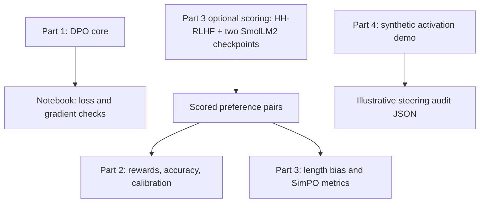

# Mission 04: Project Summary and Results

**Contributors:** Syed Hashir Sohail, Yasan Malik, Usman tariq qureshi, Sufyan Khalid  
**Group:** sustkever (Group 17)  
**Course:** Conversational AI, Winter Semester 2026/27  
**Prepared:** 2 November 2026

This report summarizes the current source code, notebook, and saved results in `mission-04`. Results described as recorded come from existing files; no training runs or benchmarks were repeated while preparing this document. The contributors are credited collectively because the mission files do not assign individual parts to named people.

## 1. What happens in this project?

Mission 04 explores how a language model can learn preferred responses, how to measure those preferences, and how to change model behavior during inference. In the assignment's starship scenario, these tasks repair AURA's Plasma Ignition & Ethical Steering Core. The actual implementation consists of four Python modules and a notebook.

The project asks four practical questions:

1. Can we implement Direct Preference Optimization (DPO) and verify that only the active policy learns?
2. Can we turn policy/reference probabilities into rewards and check whether they favor human-preferred answers?
3. How does response length affect preference scores, and what changes when SimPO removes the reference model?
4. Can an activation hook change hidden representations, and how would we measure the effect on truthfulness and reasoning?

The folder combines implementation checks, analysis of real scored preference pairs, memory measurements on a toy model, and a synthetic steering demonstration. These provide different kinds of evidence, explained below.

## 2. How the files connect

| File | Responsibility |
| --- | --- |
| [01_DPO_Loss_Core.py](01_DPO_Loss_Core.py) | Calculate response log-probabilities, implement DPO, and verify policy/reference gradients. |
| [02_Implicit_Reward_Evaluator.py](02_Implicit_Reward_Evaluator.py) | Compute implicit rewards, pairwise accuracy, Bradley-Terry probabilities, calibration, and reward-margin distributions. |
| [03_Length_Bias_and_SimPO.py](03_Length_Bias_and_SimPO.py) | Analyze length dependence, implement SimPO, compare memory use, and optionally score real preference data. |
| [04_Activation_Steering_and_Audit.py](04_Activation_Steering_and_Audit.py) | Extract concept directions, apply an activation hook, and demonstrate an alignment-tax audit. |
| [ps04_solution.ipynb](ps04_solution.ipynb) | Walk through Part 1 and retain its executed verification output. It covers the DPO core rather than all four parts. |
| [ps04_briefing.md](ps04_briefing.md) | Define the assignment requirements and role deliverables. |
| [results/](results/) | Store scored pairs, evaluation metadata, a memory benchmark log, and the synthetic steering report. |



Parts 2 and 3 read the same saved preference pairs by default. This is a collection of related experiments and reusable components; the four scripts do not form a single end-to-end pretrained-model training pipeline.

## 3. What each part does

### Part 1: DPO loss and gradient verification

`get_batch_logps` turns token logits into response log-probabilities. It shifts predictions and labels for causal language modeling, gathers the probability of each target token, and excludes prompt/padding labels marked `-100`. It can return either the summed response log-probability or its per-token average.

`DPOLoss` compares a trainable policy with a frozen reference. For each preferred/rejected answer pair, it calculates:

```text
delta_chosen   = policy_chosen_logp   - reference_chosen_logp
delta_rejected = policy_rejected_logp - reference_rejected_logp
loss = mean(-logsigmoid(beta * (delta_chosen - delta_rejected)))
```

The script uses `F.logsigmoid` for numerical stability. Its verification harness creates two tiny causal transformers, freezes the reference, and updates only the policy. It checks the vectorized calculation against a slow reference, masking behavior, extreme loss values, analytic gradients, and unchanged reference weights.

The notebook records a policy loss decrease from **0.6931 to 0.1288** during its 30-step training demonstration. All **29 policy parameter tensors** change, while the reference stays identical. This demonstrates DPO mechanics on a small synthetic batch; it does not measure general conversational alignment.

### Part 2: Implicit rewards and preference evaluation

`evaluate_implicit_rewards` computes `reward = beta * (policy_logp - reference_logp)` for each answer. The Bradley-Terry probability of preferring the chosen answer is the sigmoid of the chosen-minus-rejected reward gap.

The evaluator reports strict pairwise accuracy, with ties counted as incorrect. It also builds a calibration curve, expected calibration error, and a reward-margin histogram. Randomized A/B ordering gives the calibration calculation both positive and negative labels. A beta sweep shows that positive reward scaling changes probability confidence while preserving ranking accuracy.

By default, the script runs its self-checks, evaluates eight synthetic pairs, and then reads the real scored pairs saved by Part 3. If Matplotlib is installed, it also generates `results/bt_calibration_diagram.png`; that image is not among the existing saved artifacts reviewed for this report.

### Part 3: Length bias, SimPO, and memory

The length diagnostic correlates the difference in answer lengths with the policy-minus-reference preference margin. It includes a bootstrap confidence interval to show sampling uncertainty.

`SimPOLoss` uses average per-token policy log-probabilities and requires no reference model. Its implemented objective is:

```text
loss = mean(-logsigmoid(beta * (average_logp_chosen - average_logp_rejected) - gamma))
```

The defaults are `beta = 2.0` and `gamma = 0.5`. The script checks the formula and gradients, evaluates the saved pairs, and compares DPO/SimPO memory through tensor-byte accounting and optional CUDA or Apple MPS measurements.

The optional `--score-real` path downloads the `Anthropic/hh-rlhf` helpful-base test split, selects 100 eligible preference pairs, and scores their responses with `SmolLM2-135M-Instruct` and `SmolLM2-135M`. Selection uses seed 42, matching conversation context, complete sequences of at most 512 tokens, and no answer truncation. These checkpoints are compared as supplied; they are not fine-tuned in this experiment.

### Part 4: Activation steering and alignment tax

The steering module takes the mean difference between positive and negative activations and normalizes it into a unit-length concept direction. `ActivationSteeringHook` then adds `alpha * steering_vector` to a target layer's output, changing activations without updating model weights. The implementation uses an output forward hook; the briefing describes a pre-forward hook.

`extract_steering_vector` can capture final-token activations from a supplied transformer and tokenizer. The default demonstration instead uses synthetic activation batches and a small linear layer. Its audit generates illustrative truthfulness, reasoning, and perplexity scores for seven steering strengths between -2.0 and +2.0. A caller can supply a real evaluator to replace those formulas.

The alignment-tax helper expresses capability loss as the baseline accuracy minus the steered accuracy, in percentage points, and also calculates percentage retention. The saved report records **four passing implementation checks**. Real-model truthfulness and reasoning benchmarks remain pending.

## 4. What the saved results show

### Real preference-pair analysis

The saved evaluation uses **100 HH-RLHF pairs**, scored on CPU in float32. The instruction-tuned checkpoint is the policy and its base checkpoint is the comparison reference.

| Recorded quantity | Value | Interpretation |
| --- | --- | --- |
| Preferred answer is longer | 60 of 100 pairs | Answer length differs systematically within this selected sample. |
| Length difference vs. summed log-ratio margin | Pearson r = **-0.420** | Longer preferred answers tend to receive lower relative margins for these checkpoints. |
| Bootstrap 95% interval for that correlation | **[-0.644, -0.127]** | The recorded resamples retain a negative association. |
| Implicit-reward pairwise accuracy | **39%** | The log-ratio reward ranks the human-preferred answer higher in 39 pairs. |
| Length-normalized log-ratio correlation | **+0.170** | Normalizing both policy and reference scores changes the observed relationship. |
| SimPO margin/length correlation | **+0.159** | The reference-free, normalized score has a different length relationship. |
| SimPO loss on the saved policy scores | **1.1305** | An objective evaluation using the existing checkpoint's scores. |
| SimPO positive reward-gap rate / target-margin pass rate | **47% / 35%** | The first measures positive gaps; the second requires a gap above gamma. |

These are exploratory checkpoint comparisons. The negative correlation does not establish that the dataset rewards verbosity, and the SimPO figures do not show improvement from SimPO training. The saved metadata explicitly records `trained_here: false`.

### Memory comparison

| Measurement | DPO | SimPO | Saving |
| --- | ---: | ---: | ---: |
| Toy-model stored weights | 4.00 MiB | 2.00 MiB | 50.0% |
| CPU tensor-byte accounting: weights, gradients, optimizer state, saved activations | 15.02 MiB | 13.02 MiB | 13.3% |
| Apple M4 Pro MPS sampled peak training allocation | 13.02 MiB | 11.02 MiB | 15.3% |

Removing the frozen reference halves stored model weights, but gradients, optimizer state, and activations still consume memory. The recorded MPS peak is sampled at three training stages, so it is a lower bound on the true peak. It measures allocator use in Apple's unified memory, rather than dedicated GPU VRAM. No saved NVIDIA CUDA benchmark is present.

### Synthetic steering illustration

| Alpha | Illustrative truthfulness | Illustrative reasoning accuracy |
| ---: | ---: | ---: |
| 0.0 | 52.00% | 88.00% |
| 1.0 | 73.00% | 83.50% |
| 2.0 | 86.32% | 74.50% |

These numbers come from formulas in the demonstration. They illustrate the proposed trade-off between stronger steering and capability retention; they do not establish an effective operating range for a real model or measured performance on GSM8K or MMLU.

## 5. Where to inspect the evidence

| Artifact | Contents |
| --- | --- |
| [ps04_solution.ipynb](ps04_solution.ipynb) | Recorded Part 1 loss, numerical-stability, masking, and gradient checks. |
| [results/length_bias_scored_pairs.json](results/length_bias_scored_pairs.json) | All 100 pairs' response lengths, summed policy/reference log-probabilities, and preference-pair hashes. |
| [results/length_bias_evaluation.json](results/length_bias_evaluation.json) | Dataset/model revisions, selection rules, scoring environment, correlations, bootstrap interval, and SimPO metrics. |
| [results/memory_benchmark_mps.txt](results/memory_benchmark_mps.txt) | Saved length-analysis output, CPU accounting, and Apple MPS memory measurements. |
| [results/04_steering_demo_results.json](results/04_steering_demo_results.json) | Synthetic concept-vector information, implementation-check status, audit rows, and limitations. |
| [results/README.md](results/README.md) | Explanation of the real-data and memory evidence. |

## 6. How to run the project

Use a Python environment with PyTorch. Matplotlib is optional for the calibration image. Fresh preference scoring additionally needs Transformers and NumPy, internet access, and space for two approximately 135-million-parameter checkpoints. Open the notebook in a Jupyter-capable editor with `mission-04` as its working directory.

From the repository root, use these PowerShell commands:

```powershell
Set-Location .\mission-04
python .\01_DPO_Loss_Core.py
python .\02_Implicit_Reward_Evaluator.py
python .\03_Length_Bias_and_SimPO.py
python .\04_Activation_Steering_and_Audit.py
```

Running from this directory places Part 4's output under `mission-04/results`; that script resolves its output relative to the current working directory. Its run rewrites `04_steering_demo_results.json`. Parts 2 and 3 locate their default input files relative to their scripts.

For only the Part 2 or Part 3 self-checks:

```powershell
python .\02_Implicit_Reward_Evaluator.py --verify-only
python .\03_Length_Bias_and_SimPO.py --verify-only
```

To rescore the real preference sample and analyze the fresh scores:

```powershell
python .\03_Length_Bias_and_SimPO.py --score-real
python .\03_Length_Bias_and_SimPO.py --pairs .\logs\length_bias_real\scored_pairs.json
python .\02_Implicit_Reward_Evaluator.py --pairs .\logs\length_bias_real\scored_pairs.json
```

Rescoring writes `scored_pairs.json` and `evaluation.json` under `logs/length_bias_real/`. It leaves the default evidence in `results/` intact. Using `--pairs` selects fresh scores; making them the default also requires copying and renaming both generated files as described by the script. With `--pairs`, record the corresponding `evaluation.json` provenance alongside the report.

For a new hardware memory benchmark, choose the command matching the machine:

```powershell
# NVIDIA CUDA device
python .\03_Length_Bias_and_SimPO.py --benchmark-cuda

# Apple Silicon with MPS support
python .\03_Length_Bias_and_SimPO.py --benchmark-mps
```

## 7. Current scope and remaining evaluation

The project implements and demonstrates DPO loss mechanics, implicit reward evaluation, a reference-free SimPO objective, memory comparisons, and activation manipulation. Existing evidence supports the numerical checks, the limited real-data preference analysis, and the recorded toy-model memory comparison.

A pretrained DPO/SimPO fine-tuning study and a steering audit using actual model generations would be needed to measure improvements in conversational behavior. Neither is established by the current saved results. No individual contribution percentages or personal role assignments are recorded in the mission files.

**Assistance disclosure:** Part 3 credits Codex and Claude with drafting its implementation, checks, and report formatting, reviewed by the four contributors. Codex assisted with preparing this summary from the repository's current code and recorded evidence.
